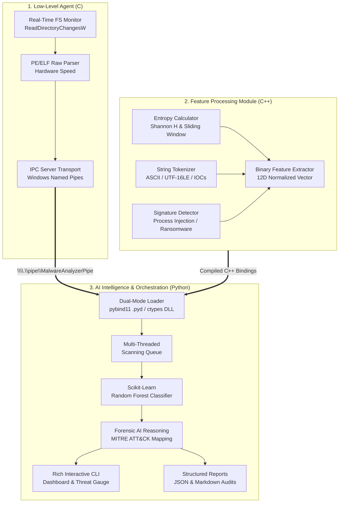

# Autonomous AI-Powered Malware Sandbox & Code Analyzer

A localized, high-performance hybrid system for dynamic malware analysis, binary auditing, and real-time threat classification built with **C**, **C++**, and **Python**.

---

## Architecture Overview



---

## Languages & Layer Separation

### 1. Low-Level Agent (Built in C)
* **Core Function**: High-throughput raw system access and file-system hooking.
* **Capabilities**:
  * Real-time directory monitoring via Windows kernel notifications (`ReadDirectoryChangesW`).
  * Instant hardware-speed parsing of PE headers (DOS, NT, Section headers, W^X violations, security mitigations: ASLR, DEP/NX, CFG) and ELF headers (Class, Endianness, W+X `PT_LOAD` segments).
  * High-speed binary IPC transmission over Windows Named Pipes (`\\.\pipe\MalwareAnalyzerPipe`) using packed binary structures (`IPCMessagePacket`).

### 2. Features Processing Module (Built in C++)
* **Core Function**: Memory-safe, high-speed binary parsing and mathematical feature extraction.
* **Capabilities**:
  * **Shannon Entropy Calculator**: Computes byte distribution histogram, overall file entropy ($H \in [0.0, 8.0]$), and chunked sliding-window curves to detect packed or encrypted code layers.
  * **String Tokenizer & IOC Extractor**: Scans memory buffers for ASCII and UTF-16LE strings; classifies IPv4 addresses, URLs, Tor `.onion` addresses, high-risk Windows APIs, and execution command lines.
  * **Structural Signature Detector**: Evaluates behavioral rules (Process Injection, System Recovery Inhibition / Shadow Copy deletion, Ransomware demand markers, Obfuscated PowerShell execution).
  * **Binding Layer**: Dual-mode export via native Python `pybind11` extension (`feature_engine.pyd`) and standard C-linkage DLL (`features_engine.dll` / `extern "C"`).

### 3. AI Intelligence & Orchestration (Built in Python)
* **Core Function**: Pipeline orchestration, localized machine learning classification, and forensic reporting.
* **Capabilities**:
  * **Dual-Mode Bindings Loader**: Automatically loads compiled `pybind11` module or falls back to `ctypes` DLL.
  * **Localized Machine Learning Model**: Scikit-Learn ensemble model (`RandomForestClassifier`) classifying samples into `CLEAN`, `SUSPICIOUS`, `MALICIOUS`, or `CRITICAL` with probability confidence scores.
  * **AI Forensic Reasoning Engine**: Synthesizes findings into attack vectors, MITRE ATT&CK technique tags, and incident response remediation plans (supports local heuristic reasoning and Google Gemini API).
  * **Rich CLI Dashboard**: Terminal telemetry cards, entropy meters, threat level gauges, IOC tables, and rule hit breakdowns.
  * **Structured Reporting**: Exports detailed JSON reports and complete Markdown audit files.

---

## Project Structure

```text
Code-Analyzer/
├── c_agent/                      # Low-Level C Agent
│   ├── include/
│   │   ├── agent_common.h        # IPC packet protocol & definitions
│   │   ├── pe_parser.h           # PE32/PE32+ header parser header
│   │   ├── elf_parser.h          # ELF32/ELF64 parser header
│   │   ├── fs_monitor.h          # Directory monitor header
│   │   └── ipc_transport.h       # Windows Named Pipe transport
│   ├── src/
│   │   ├── pe_parser.c           # PE parser implementation
│   │   ├── elf_parser.c          # ELF parser implementation
│   │   ├── fs_monitor.c          # Real-time directory monitoring
│   │   ├── ipc_transport.c       # Named Pipe server implementation
│   │   └── main.c                # C agent CLI entrypoint
│   └── c_agent.exe               # Compiled C agent executable
├── cpp_engine/                   # C++ Feature Extraction Engine
│   ├── include/
│   │   ├── entropy_calculator.hpp
│   │   ├── string_tokenizer.hpp
│   │   ├── signature_detector.hpp
│   │   ├── binary_feature_extractor.hpp
│   │   └── c_bindings.h
│   ├── src/
│   │   ├── entropy_calculator.cpp
│   │   ├── string_tokenizer.cpp
│   │   ├── signature_detector.cpp
│   │   ├── binary_feature_extractor.cpp
│   │   ├── c_bindings.cpp
│   │   └── pybind_module.cpp
│   ├── features_engine.dll       # Compiled C++ shared library (ctypes)
│   └── feature_engine.pyd        # Compiled PyBind11 Python extension
├── python_orchestrator/          # Python AI & Orchestration Layer
│   ├── bindings_loader.py        # Dual-mode C++/Python loader
│   ├── ai_classifier.py          # ML Threat Classifier & LLM reasoning
│   ├── scanner_queue.py          # Multi-threaded scanning queue
│   ├── ipc_client.py             # Windows Named Pipe IPC client
│   ├── reporting.py              # JSON & Markdown report generators
│   ├── cli_dashboard.py          # Rich terminal dashboard
│   └── main.py                   # Main CLI entrypoint
├── samples/                      # Test binary & script samples
│   ├── clean_utility.c / .exe    # Benign system utility sample
│   ├── simulated_packer.c / .exe # High-entropy packed binary sample
│   ├── simulated_trojan.c / .exe # Process injection & C2 sample
│   ├── simulated_ransomware.c    # Shadow copy & extortion simulator
│   └── malicious_script.ps1      # Obfuscated PowerShell dropper
├── reports/                      # Generated security audit reports
├── build.bat                     # Windows automated build script
├── Makefile                      # Linux/macOS build script
└── README.md
```

---

## Quick Start & Usage

### 1. Build the System
Run the build script to compile the C agent, C++ shared library, PyBind11 module, and sample binaries:

```cmd
build.bat
```

### 2. Run the Multi-Sample Benchmark Suite
Test all binary profiles (Clean, Packed, Trojan, Ransomware, PowerShell Dropper):

```cmd
python -m python_orchestrator.main demo
```

### 3. Scan a Specific Binary or Script
Analyze any executable, DLL, or script directly:

```cmd
python -m python_orchestrator.main scan samples/simulated_trojan.exe
```

### 4. Real-Time Directory Interception (C Agent + Python IPC)
Spawn the low-level C agent to monitor a sandbox drop directory and stream events to Python in real time:

```cmd
python -m python_orchestrator.main live-agent --watch sandbox_dropzone
```

Any file copied, created, or modified inside `sandbox_dropzone/` is intercepted by the C agent, previewed at hardware speed, transferred over the Named Pipe, and immediately analyzed by the C++ engine and AI classifier!

### 5. Inspect Generated Security Reports
JSON and Markdown reports are saved to `reports/`:
* `reports/report_<filename>_<timestamp>.json`
* `reports/security_audit_<filename>_<timestamp>.md`

